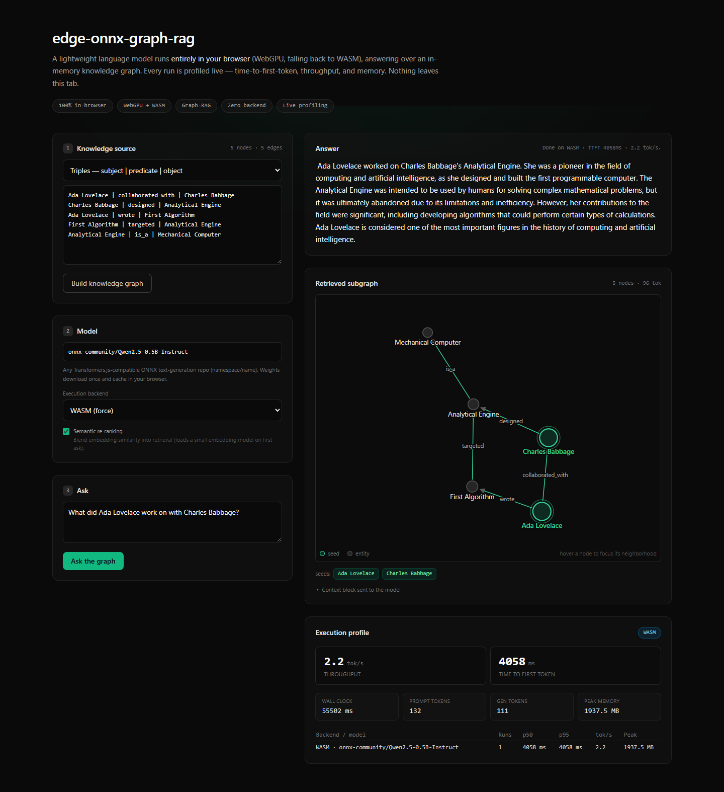
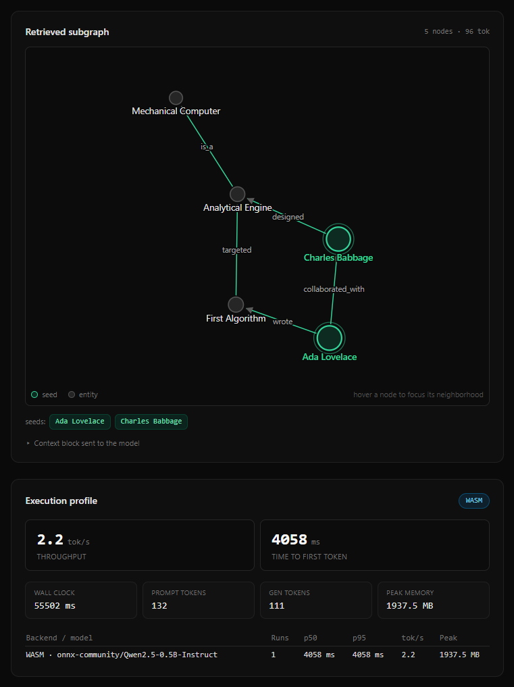

# edge-onnx-graph-rag

Zero-cost, fully client-side Graph-RAG. Lightweight transformer models execute
in the browser via WebGPU (with a WASM fallback) over an in-memory knowledge
graph, instrumented by a high-resolution execution profiler. No server-side
inference; nothing leaves the browser.



See [`CLAUDE.md`](CLAUDE.md) for the engineering ledger and [`ROADMAP.md`](ROADMAP.md)
for the phase plan.

## Highlights

- **Runtime backend negotiation** — WebGPU (4-bit weights) with a graceful WASM
  fallback (8-bit); each backend applies its own precision default. A UI selector
  can pin **Auto / WebGPU / WASM** to compare them on the same device.
- **In-memory knowledge graph** — adjacency-list store, k-hop / weighted-shortest-path
  traversal, dependency-free entity extraction, and token-bounded context assembly.
- **Hybrid structural + semantic retrieval** — a sentence-embedding model
  (`all-MiniLM-L6-v2`, in the same worker) embeds the graph and the query. Seeds
  resolve by exact label match, falling back to semantic similarity when the query
  names no graph entity ("who built the calculating machine?" still anchors on the
  right nodes); the retrieved neighborhood is then re-ranked by blending k-hop
  proximity with cosine similarity before context packing. Best-effort: any
  embedding failure degrades to structural retrieval.
- **Worker-offloaded inference** — the engine, model load, and token decoding run
  in a Web Worker; the main thread stays responsive and only builds the prompt
  and renders streamed tokens.
- **Live execution profiler** — measured TTFT, throughput, wall-clock, prompt count,
  exact generated-token count (decode steps, not text deltas), and (where the API
  is exposed) peak memory, aggregated per backend/model.
- **Retrieved-subgraph visualization** — the neighborhood behind each answer is
  drawn as an interactive graph (deterministic force layout, seeds highlighted,
  neighborhood highlight on hover).
- **Real model-download progress**, streamed answers, and cross-origin isolation
  for WASM threads.

## Architecture

```
text / model output ─► extraction ─► GraphBuilder ─► GraphStore
                                                          │
        query ─► seed resolution ─► retrieveNeighborhood ─► rerank ─► assembleContext
                 (label → semantic)                         (hybrid)      │
                             promptTemplate ─► InferenceEngine ─► answer + metrics
                                                          │
                                            retrieved subgraph ─► visualization
```

- **Engine** (`src/core/engine`) — runtime capability negotiation (WebGPU → WASM),
  a backend-agnostic `InferenceEngine`, and Transformers.js-backed backends with
  streamed token generation.
- **Graph** (`src/core/graph`) — adjacency-list store, k-hop / weighted-path
  traversal, dependency-free entity extraction, token-bounded context assembly,
  and pure similarity utilities (`similarity.ts`: cosine, hybrid re-ranking,
  semantic seed resolution) that take embeddings as plain vectors.
- **Pipeline** (`src/core/pipeline`) — `GraphRagPipeline` composing the above;
  depends only on the `InferenceEngine` contract.
- **Profiler** (`src/core/profiler`) — TTFT / throughput / memory instrumentation
  and cross-run aggregation.
- **UI** (`app`, `components`, `lib`) — Next.js App Router + Tailwind console.
  Inference runs in a **Web Worker** (`lib/inference.worker.ts`): the engine,
  model load, and token decoding stay off the main thread; the main thread only
  builds the prompt (retrieval + assembly) and renders streamed tokens. The
  worker is fronted by `WorkerEngineClient`, which implements `InferenceEngine`
  so the pipeline is agnostic to the thread boundary. The retrieved subgraph is
  laid out by a pure, deterministic function (`lib/subgraphLayout.ts`) and drawn
  as inline SVG (`components/SubgraphGraph.tsx`).

## Commands

```bash
npm install
npm run typecheck   # tsc --noEmit, strict
npm run lint        # ESLint
npm run test        # Vitest unit suite (DOM-free; runs without a browser)
npm run dev         # Next.js dev server → http://localhost:3000
npm run build       # production build
```

## Running the UI

```bash
npm run dev
```

Open the app, edit the knowledge source (triples or free text), click **Build
graph**, optionally pin an execution backend, enter a query, and **Ask**. The
first ask downloads and caches the model weights in the browser, negotiates a
backend, then streams the answer while the profiler reports TTFT, throughput, and
(where available) peak memory. The subgraph that grounded the answer is drawn
beside it.



Screenshots are captured from the production build (`next start`) on the WASM
backend in Microsoft Edge.

### Cross-origin isolation

WASM multi-threading and `SharedArrayBuffer` require cross-origin isolation. The
dev/prod server sets `Cross-Origin-Opener-Policy: same-origin` and
`Cross-Origin-Embedder-Policy: credentialless` (see [`next.config.mjs`](next.config.mjs)).
Without isolation the WASM backend falls back to single-threaded execution.

## Deploying (free)

The app is fully static and all inference runs in the visitor's browser; model
weights are fetched from the Hugging Face CDN, not from your host. Any static-capable
host works at no cost; Vercel's free Hobby plan needs zero configuration:

1. Sign in at [vercel.com](https://vercel.com) with GitHub.
2. **Add New → Project**, import this repository, keep the detected Next.js
   defaults, and **Deploy**.

The COOP/COEP headers in [`next.config.mjs`](next.config.mjs) are applied by Vercel
as-is, so the deployed page is cross-origin isolated (WASM threads enabled). No
environment variables are required.

## Status

The client-side core is complete and unit-tested (**131 tests**, strict type-check
and lint clean). End-to-end inference has been exercised in a real browser on
**both backends**: WebGPU (4-bit) and the WASM fallback (8-bit) each load a live
model, stream a grounded answer, and report measured profiler metrics. Hybrid
retrieval (embedder, semantic re-ranking, semantic seed resolution) is verified
live as well.

CI (`.github/workflows/ci.yml`) runs `npm ci` → typecheck → lint → test → build on
Node 22. The lockfile is cross-platform (it records every platform's native
optional binaries); regenerate it with npm 11 when dependencies change, since
older npm versions prune non-host binaries.

`next build` succeeds; the ONNX/Transformers.js runtime loads lazily in a separate
chunk (in the worker), never on first paint or during SSR. `next.config.mjs` flags
`onnxruntime-web`'s pre-minified worker bundles as already minimized so Terser
skips them (they use `import.meta`, which Terser rejects when re-minifying ESM
assets as non-modules).

## License

MIT — see [`LICENSE`](LICENSE).
